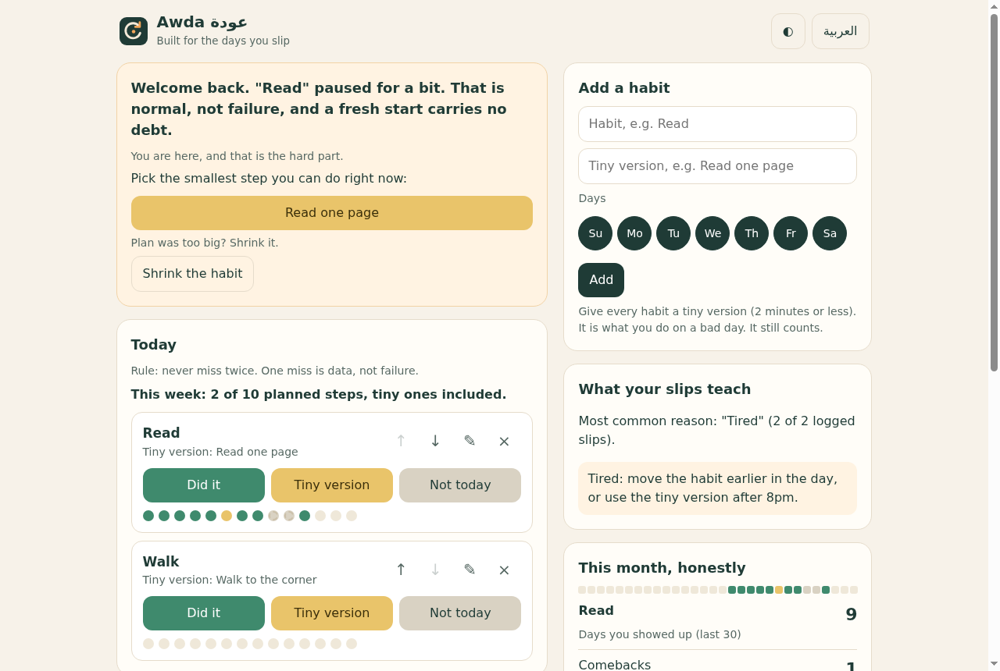
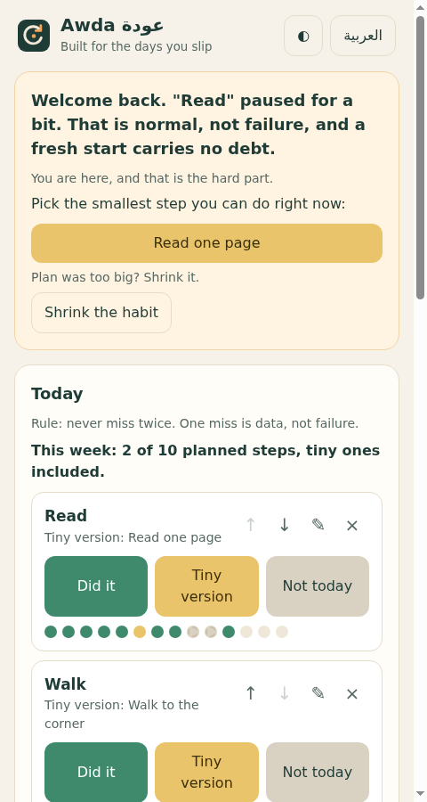
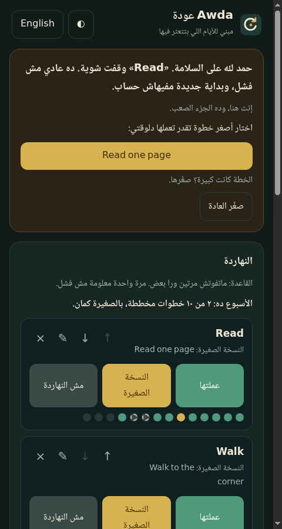
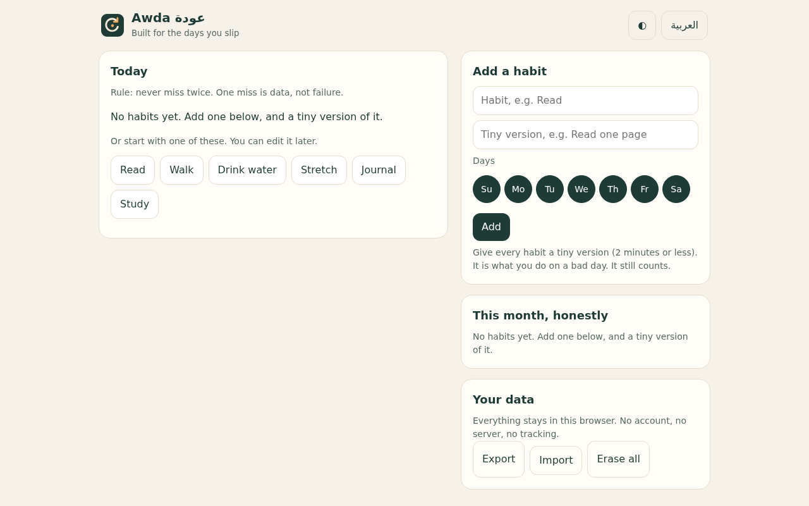
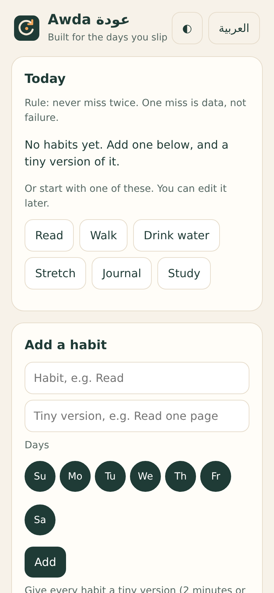

<div align="center">


# Awda | عودة

**A habit tracker that expects you to slip, and helps you come back without self-blame.**

[**Open the live demo**](https://yousefkhames.github.io/awda/) · Arabic (RTL) + English · Free · Private · Works offline



<p>

&nbsp;&nbsp;

</p>

</div>

## Screenshots

Captured from the live site (https://yousefkhames.github.io/awda/).

<p>
  
  
</p>

## Why
Most trackers reward an unbroken streak and punish a missed day. That is when people quit. Awda is built around the day after a miss: it treats a slip as data, asks for the smallest next step, and measures how often you return instead of how long you stayed perfect.

## Features
- **No streaks.** Shows days you showed up, comebacks, and a return rate.
- **Tiny version for every habit** (2 minutes or less) that counts as a win.
- **Welcome-back card** after a miss: smallest step, or shrink the habit.
- **Weekly schedule.** Unplanned days are rest days, not misses. Tap past dots to backfill.
- **Slip reasons** (optional) feed tailored tips such as "Tired: move it earlier".
- **30-day heatmap** per habit, weekly summary, comeback celebration.
- **Daily reminder** as a downloadable calendar file (.ics). Nothing leaves your device.
- **Arabic and English** with true RTL, Arabic digits, dark mode, installable offline PWA.
- **Private by design.** Data lives only in your browser. Export and import (validated, merge or replace).
- **Accessible.** Landmarks, skip link, live announcements, 44px targets, visible focus, forced-colors and reduced-motion support, print styles.

## Tech stack
Plain HTML, CSS and JavaScript. No framework, no build step, no dependencies. `localStorage` for data, a service worker for offline, Web App Manifest for install. Hosted on GitHub Pages from `/docs`.

## Run it
```bash
git clone https://github.com/yousefkhames/awda.git
cd awda/docs && python3 -m http.server 8080   # then open http://localhost:8080
```
Or just open `docs/index.html`.

## Tests
`tests/run.sh` drives the real app in headless Chrome (desktop and mobile widths, English and Arabic): logging, undo, skip-reason dialog, add, edit, reorder, duplicate guard, bad-import rejection, theme and language switch, overflow and console-error checks.

## Research behind it
The "never miss twice" rule, self-compassion after lapses ([PMC10543633](https://pmc.ncbi.nlm.nih.gov/articles/PMC10543633/)), and system-driven lapse management ([CHI 2016](http://eagapie.com/pubs/chi2016_stayingthecourse.pdf)).

## Honest limits
- Data is per browser and device. No cloud sync, so use Export to move or back up.
- No push notifications. Reminders use your calendar app through the .ics file.
- The test suite is a browser smoke and flow test, not full unit coverage.
- The name "Awda" has not been trademark-checked.

## License
MIT. See [LICENSE](LICENSE).
